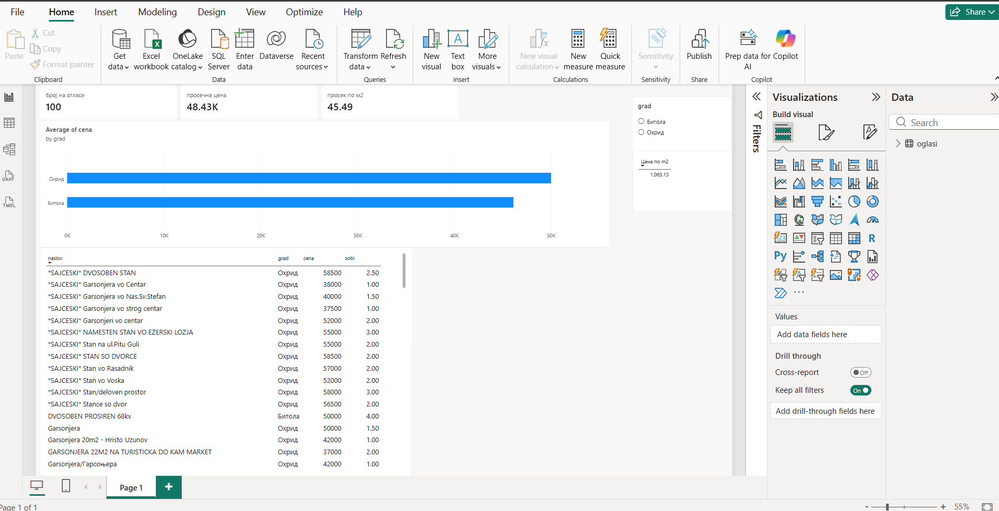

# Reklama5 Watcher 🏠

A local web app that tracks apartment listings on [reklama5.mk](https://www.reklama5.mk) (the largest classifieds site in North Macedonia) using custom filters, and sends a **Telegram notification** when a new listing appears.

I built it to follow the apartment market in Bitola and Ohrid, then used the collected data to practice **SQL, Excel and Power BI** analysis.



## Features

- **Web scraper** (requests + BeautifulSoup) that parses price, m², rooms, city and posting date
- **Custom filters**: city, category, price range, m², rooms, required / excluded keywords
- **Background checks** every N minutes, with Telegram or ntfy push notifications
- **Web UI** (Flask): listing cards, "new" badges, favorites, hide, sorting by price / size
- **SQLite** storage, with listings linked to the filter that found them

## Data analysis

The collected data is analysed in three ways:

| Tool | What I did |
|---|---|
| **SQL** | Aggregations, `GROUP BY` / `HAVING`, `CASE WHEN` price bands, `JOIN`s, NULL handling (`sql_zadaci.py`) |
| **Excel** | Tables, `AVERAGEIFS` / `COUNTIF`, PivotTables and PivotCharts |
| **Power BI** | KPI cards, slicers, cross-filtering, DAX measures (`CALCULATE`, `DIVIDE`) |

**Example findings:**
- Ohrid listings were about **40% more expensive per m²** than Bitola (≈1,230 vs ≈870 €/m²), even though the Ohrid apartments were smaller on average.
- A single listing without m² was inflating the "price per m²" figure. I fixed this with `CALCULATE(..., NOT ISBLANK(m2))`.
- The dataset only contains listings that passed the filters (for example, ads with "price on request" are excluded), which limits what conclusions can be drawn from it.

## Tech stack

Python · Flask · BeautifulSoup · SQLite · openpyxl · Power BI · Excel

## Run locally

```bash
python -m venv .venv
.venv\Scripts\activate        # Windows
pip install -r requirements.txt
python app.py
```

Open **http://127.0.0.1:5000**, add a filter, and (optionally) set up Telegram in **Settings**.

> The database (`reklama5.db`) is not included in the repo because it stores the Telegram bot token.
